# 一周哑铃全身训练计划与动作 GIF 图鉴

适用于健康成年人，仅需哑铃和一块可躺卧的地面。文档包含两套方案：

- 初中级：每周训练 3 天，每次约 45～60 分钟。
- 中级：每周训练 5 天，每次约 45～65 分钟。
- 每组结束时保留约 2～3 次余力，最后几次明显吃力，但不必练到力竭。

## 一、初中级方案：每周 3 练

| 星期 | 训练内容 | 训练重点 |
|---|---|---|
| 周一 | 全身 A | 深蹲、髋铰链、胸背和肩部 |
| 周二 | 休息或快走 | 20～30 分钟轻度活动 |
| 周三 | 全身 B | 单腿、臀部、胸背和手臂 |
| 周四 | 休息或拉伸 | 轻度恢复 |
| 周五 | 全身 C | 臀腿后侧、胸背、肩部和核心 |
| 周六 | 可选轻度活动 | 快走、骑车或活动度训练 |
| 周日 | 完全休息 | 睡眠和恢复 |

### 周一：全身 A

| 编号 | 动作 | 组数 × 次数 |
|---:|---|---:|
| 01 | 高脚杯深蹲 | 3×8～12 |
| 02 | 哑铃罗马尼亚硬拉 | 3×8～12 |
| 03 | 哑铃地板卧推 | 3×8～12 |
| 04 | 单臂哑铃划船 | 3×10～12/侧 |
| 05 | 站姿哑铃推举 | 2×8～12 |
| 06 | 站姿哑铃提踵 | 2×12～20 |
| 07 | 死虫式 | 2×8～12/侧 |

### 周三：全身 B

| 编号 | 动作 | 组数 × 次数 |
|---:|---|---:|
| 08 | 哑铃反向弓步 | 3×8～10/侧 |
| 09 | 哑铃臀桥 | 3×10～15 |
| 10 | 窄距哑铃地板卧推 | 3×8～12 |
| 11 | 双臂俯身哑铃划船 | 3×8～12 |
| 12 | 哑铃侧平举 | 2×12～15 |
| 13 | 锤式弯举 | 2×10～15 |
| 14 | 头后哑铃臂屈伸 | 2×10～15 |
| 15 | 侧平板支撑 | 2×20～40 秒/侧 |

### 周五：全身 C

| 编号 | 动作 | 组数 × 次数 |
|---:|---|---:|
| 16 | 双哑铃前蹲 | 3×8～12 |
| 02 | 哑铃罗马尼亚硬拉 | 3×8～12 |
| 17 | 交替哑铃地板卧推 | 3×8～10/侧 |
| 04 | 单臂哑铃划船 | 3×10～12/侧 |
| 18 | 阿诺德推举 | 2×8～12 |
| 19 | 单腿哑铃提踵 | 2×12～15/侧 |
| 20 | 单侧哑铃提行或原地踏步 | 2×30～45 秒/侧 |

## 二、中级方案：每周 5 练

建议在能够稳定完成每周 3 练、动作熟练且恢复良好后采用。

| 星期 | 训练主题 | 主要部位 |
|---|---|---|
| 周一 | 推 | 胸、肩、肱三头肌 |
| 周二 | 下肢 A | 股四头肌、臀部、小腿、核心 |
| 周三 | 拉 | 背部、肱二头肌、侧腹 |
| 周四 | 休息 | 完全休息或轻度活动 |
| 周五 | 下肢 B | 臀腿后侧、小腿、核心 |
| 周六 | 全身综合 | 全身补量和手臂 |
| 周日 | 休息 | 完全休息 |

### 周一：推

| 编号 | 动作 | 组数 × 次数 |
|---:|---|---:|
| 03 | 哑铃地板卧推 | 4×6～10 |
| 05 | 站姿哑铃推举 | 3×8～12 |
| 10 | 窄距哑铃地板卧推 | 3×8～12 |
| 12 | 哑铃侧平举 | 3×12～15 |
| 14 | 头后哑铃臂屈伸 | 3×10～15 |

### 周二：下肢 A

| 编号 | 动作 | 组数 × 次数 |
|---:|---|---:|
| 16 | 双哑铃前蹲 | 4×6～10 |
| 08 | 哑铃反向弓步 | 3×8～12/侧 |
| 09 | 哑铃臀桥 | 3×10～15 |
| 06 | 站姿哑铃提踵 | 4×12～20 |
| 07 | 死虫式 | 3×8～12/侧 |

### 周三：拉

| 编号 | 动作 | 组数 × 次数 |
|---:|---|---:|
| 04 | 单臂哑铃划船 | 4×8～12/侧 |
| 11 | 双臂俯身哑铃划船 | 3×8～12 |
| 13 | 锤式弯举 | 3×10～15 |
| 15 | 侧平板支撑 | 3×30～45 秒/侧 |

### 周五：下肢 B

| 编号 | 动作 | 组数 × 次数 |
|---:|---|---:|
| 02 | 哑铃罗马尼亚硬拉 | 4×8～12 |
| 08 | 哑铃反向弓步 | 3×10/侧 |
| 09 | 哑铃臀桥 | 3×12～15 |
| 19 | 单腿哑铃提踵 | 3×12～20/侧 |
| 20 | 单侧哑铃提行或原地踏步 | 3×40～60 秒/侧 |

### 周六：全身综合

| 编号 | 动作 | 组数 × 次数 |
|---:|---|---:|
| 01 | 高脚杯深蹲 | 3×10～12 |
| 17 | 交替哑铃地板卧推 | 3×8～10/侧 |
| 04 | 单臂哑铃划船 | 3×10/侧 |
| 18 | 阿诺德推举 | 3×8～12 |
| 13 | 锤式弯举 | 2×12～15 |
| 14 | 头后哑铃臂屈伸 | 2×12～15 |

锤式弯举和头后臂屈伸可以组成超级组。连续疲劳或表现下降时，优先将周六每个动作减少 1 组。

## 三、20 个动作 GIF 图鉴

### 01 高脚杯深蹲

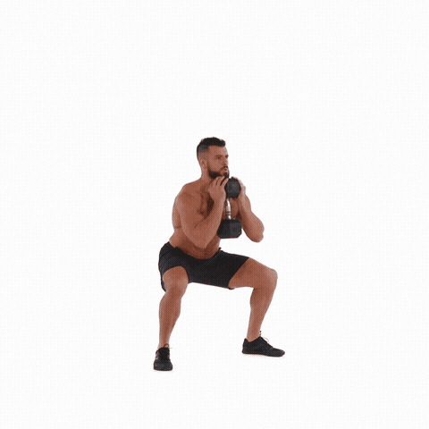

- 主要部位：大腿前侧、臀部、核心。
- 动作要点：哑铃贴近胸口，膝盖沿脚尖方向移动，脚掌全程踩稳。
- [网络来源](https://www.pinterest.com/pin/goblet-squat--832603049843802501/)

### 02 哑铃罗马尼亚硬拉

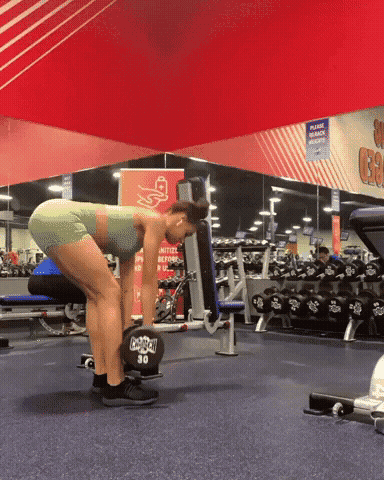

- 主要部位：臀部、大腿后侧。
- 动作要点：膝盖微屈、臀部向后推，哑铃贴近腿部，背部保持中立。
- [网络来源](https://giphy.com/gifs/gymshark-rdl-MDyNRHtMyny0yK9Dr6)

### 03 哑铃地板卧推

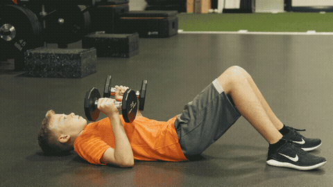

- 主要部位：胸部、肱三头肌。
- 动作要点：肘部与躯干约呈 30～45°，上臂轻触地面后稳定推起。
- [网络来源](https://www.dickssportinggoods.com/protips/sports-and-activities/exercise-and-fitness/how-to-do-the-dumbbell-floor-press)

### 04 单臂哑铃划船

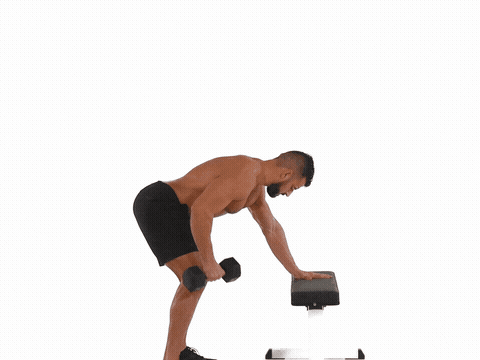

- 主要部位：背部、肱二头肌。
- 动作要点：髋部后移，两侧肩膀保持水平，将肘部向髋部方向拉。
- [网络来源](https://www.ifastfitness.com/blogs/blog/how-to-do-inverted-row)

### 05 站姿哑铃推举

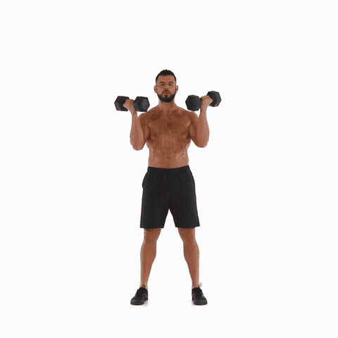

- 主要部位：肩部、肱三头肌。
- 动作要点：收紧腹部和臀部，肋骨不要外翻，避免腰部后仰借力。
- [网络来源](https://giphy.com/gifs/dumbbell-shoulder-press-3vmCnumMmnaU4SUL4w)

### 06 站姿哑铃提踵

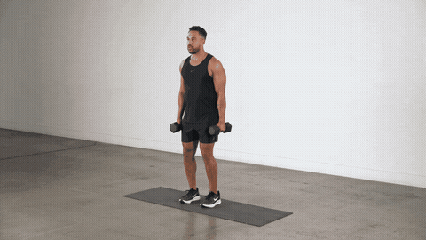

- 主要部位：小腿。
- 动作要点：垂直抬起脚跟，最高点停顿一秒，再缓慢下放。
- [网络来源](https://fitnessgarage.app/blog/ar/)

### 07 死虫式

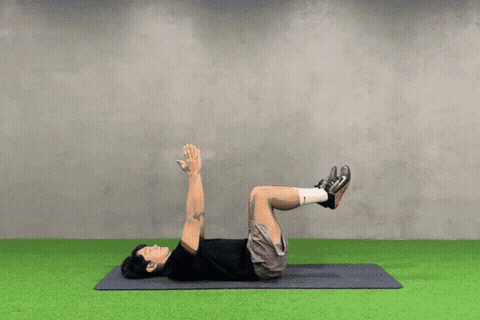

- 主要部位：腹部、核心抗伸展能力。
- 动作要点：腰背贴住地面，对侧手脚缓慢伸展；腰部抬起时缩小幅度。
- [网络来源](https://www.worldgymtaiwan.com/blog/health-knowledge/sports-safety/best-sit-up-alternatives)

### 08 哑铃反向弓步

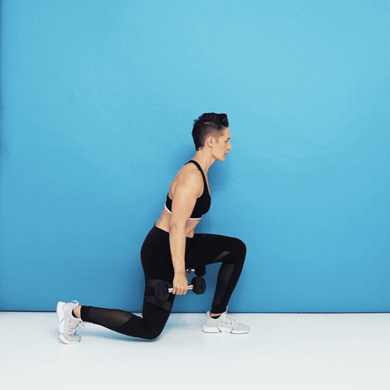

- 主要部位：大腿、臀部。
- 动作要点：后脚向后落地，前脚保持稳定，前膝沿脚尖方向移动。
- [网络来源](https://www.self.com/gallery/10-minute-total-body-dumbbell-hiit-workout)

### 09 哑铃臀桥

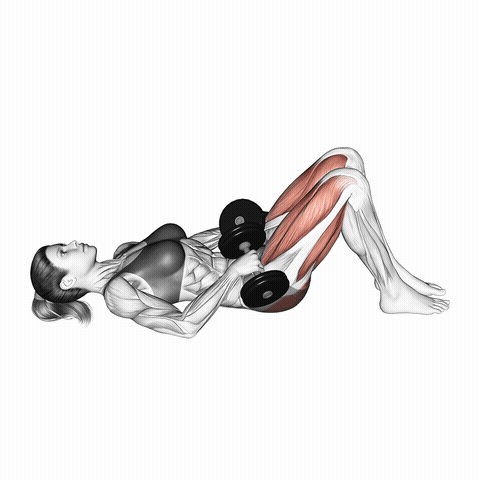

- 主要部位：臀部、大腿后侧。
- 动作要点：哑铃稳放在髋部，收住肋骨，以臀部发力抬髋。
- [网络来源](https://www.speediance.com/blogs/fitness/lower-body-pushing-exercises)

### 10 窄距哑铃地板卧推

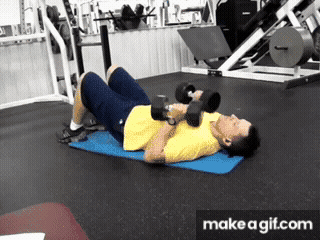

- 主要部位：胸部、肱三头肌。
- 动作要点：两只哑铃始终相互挤压，肘部靠近身体，受控下放后推起。
- [网络来源](https://makeagif.com/gif/floor-press-close-grip-dumbbell-BUxJBf)

### 11 双臂俯身哑铃划船

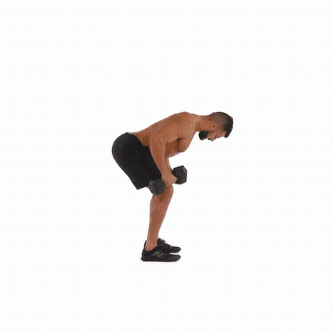

- 主要部位：背部、后肩。
- 动作要点：保持髋铰链和背部平直，同时将两只哑铃拉向腰侧。
- [网络来源](https://hips.hearstapps.com/hmg-prod/images/workouts/2016/03/dumbbellrow-1457030613.gif)

### 12 哑铃侧平举

- 主要部位：三角肌中束。
- 动作要点：肘部微屈，抬到肩部附近即可，避免耸肩和甩动身体。
- [网络来源](https://giphy.com/explore/lateral-raise)

### 13 锤式弯举

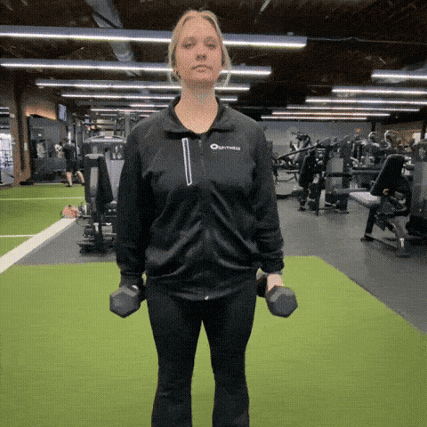

- 主要部位：肱二头肌、前臂。
- 动作要点：掌心相对、肘部贴近身体，只移动前臂，不要摆动躯干。
- [网络来源](https://giphy.com/explore/hammer-curls)

### 14 头后哑铃臂屈伸

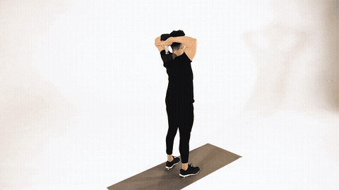

- 主要部位：肱三头肌。
- 动作要点：上臂尽量保持竖直，肘尖朝前，收紧核心避免腰部后仰。
- [网络来源](https://www.jefit.com/exercises/247/dumbbell-tricep-extension)

### 15 侧平板支撑

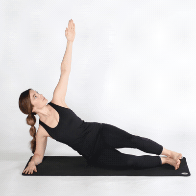

- 主要部位：侧腹、核心稳定肌群。
- 动作要点：头、肩、髋、脚踝尽量连成直线，保持髋部不下沉。
- [网络来源](https://in.pinterest.com/pin/689895236671376945/)

### 16 双哑铃前蹲

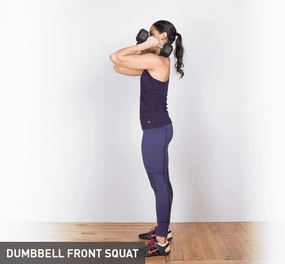

- 主要部位：大腿、臀部、核心。
- 动作要点：哑铃稳定在肩部，躯干尽量直立，脚掌全程贴地。
- [网络来源](https://greatist.com/fitness/30-dumbbell-exercises-missing-your-routine)

### 17 交替哑铃地板卧推

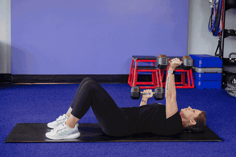

- 主要部位：胸部、肱三头肌、核心。
- 动作要点：一侧推起时另一侧保持稳定，抵抗身体向一侧旋转。
- [网络来源](https://www.anytimefitness.com/blog/beginner-strength-workout-how-to-get-started-in-the-gym)

### 18 阿诺德推举

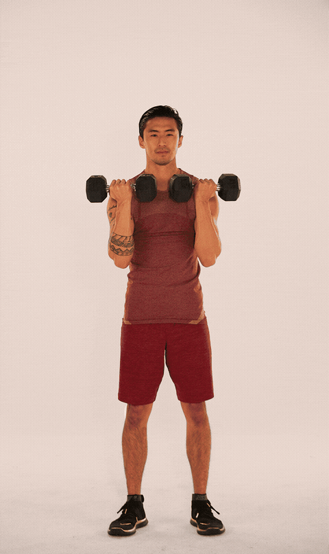

- 主要部位：肩部。
- 动作要点：推举过程中自然旋转掌心；肩部不适时改做普通哑铃推举。
- [网络来源](https://giphy.com/explore/arnold-press)

### 19 单腿哑铃提踵

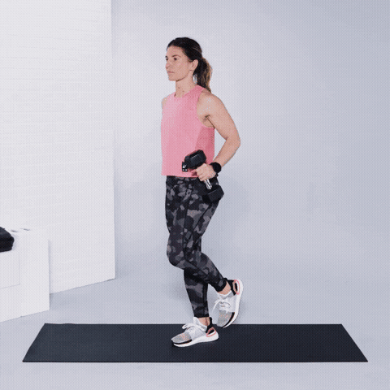

- 主要部位：小腿、踝关节稳定肌群。
- 动作要点：必要时用空手轻扶墙面，垂直提踵并控制下放。
- [网络来源](https://irace.vn/cach-xu-ly-15-chan-thuong-pho-bien-o-runner/)

### 20 单侧哑铃提行或原地踏步

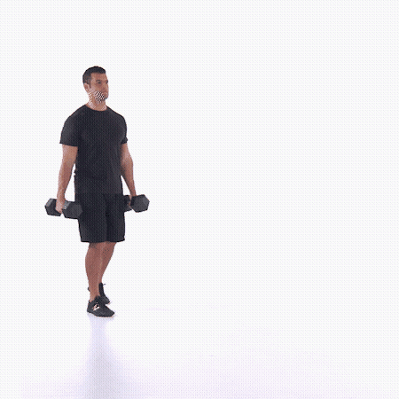

- 主要部位：核心、握力、肩胛稳定肌群。
- 动作要点：单手持铃并保持双肩水平；空间足够就行走，否则原地交替抬膝。
- [网络来源](https://www.menshealth.com/fitness/a20695529/dumbbell-carry/)

## 四、执行规则

### 热身

每次训练前完成 6～8 分钟热身：

1. 原地快走 1 分钟。
2. 徒手深蹲 10 次。
3. 徒手髋铰链 10 次。
4. 反向弓步每侧 6 次。
5. 手臂画圈、肩胛后缩各 10 次。
6. 当天第一个下肢和上肢复合动作各做一组轻重量热身。

### 重量与休息

- 复合动作组间休息 90～120 秒。
- 侧平举、弯举、臂屈伸和核心动作休息 45～75 秒。
- 初学阶段可以先完成每个动作 2 组，动作稳定后再增加至计划组数。
- 如果连续两次训练都达到次数上限且仍保留 2 次以上余力，下次增加重量。
- 哑铃重量固定时，可以增加次数，或将下放过程延长至 3 秒。

### 安全提示

出现锐痛、胸痛、异常气短或眩晕时应立即停止。有关节旧伤、心血管疾病或其他慢性病时，请先咨询医生或康复专业人员。GIF 仅用于理解动作轨迹，训练时以稳定、无痛的动作范围为准。
