# 30岁男性｜8周竖向劈叉训练计划

适用人群：没有急性下肢伤病，能无痛完成弓步和髋铰链的成年人。计划为每周 5 天、每次约 25～42 分钟，左右两侧同量训练。

> 8 周是一个复测周期，不是保证“落地”的期限。骨性结构、旧伤、训练史和当前离地高度都会影响进度。

## 训练装备

- 瑜伽垫、瑜伽砖 2 块
- 毛巾或滑盘
- 稳固长凳或椅子
- 可选：轻哑铃
- 卷尺或同规格瑜伽砖，用于固定条件复测

## 8周进阶

| 阶段 | 重点 | 静态拉伸 | 力量/专项要求 |
|---|---|---|---|
| 第1–2周 | 建立动作与耐受 | 2组，每组20–30秒，拉伸感4–5/10 | 力量动作保留约3次余力 |
| 第3–4周 | 增加训练量 | 3组，每组30–40秒 | 每周只增加一个变量：组数、时间或幅度 |
| 第5–6周 | 末端力量与PNF | 40–60秒；PNF为收缩5秒+放松20秒 | 竖叉位等长3×8–10秒 |
| 第7周 | 整合专项角度 | 支撑竖叉3×30–45秒 | 方髋和主动退出优先于深度 |
| 第8周 | 减量与复测 | 前半周减量30–40% | 复测前休息48小时 |

## 每周安排

### 周一：前腿腘绳肌（约38分钟）

1. 快走升温：5分钟
2. 腿前后摆：2×10/侧
3. 罗马尼亚硬拉：3×8–10，慢速下放3秒
4. 仰卧主动直腿抬高：3×8/侧
5. 半劈叉腘绳肌拉伸：3×30–45秒/侧
6. 支撑竖叉：2×20–30秒/侧

### 周二：后腿髋屈肌与股四头（约35分钟）

1. 快走升温：4分钟
2. 站姿髋绕环：2×8/侧
3. 腿前后摆：2×10/侧
4. 反向弓步：3×8/侧
5. 跪姿髋屈肌拉伸：3×30–45秒/侧
6. 沙发式股四头拉伸：2×30秒/侧
7. 臀桥：3×12
8. 支撑竖叉：2×20–30秒/侧

### 周三：力量与主动柔韧（约42分钟）

1. 快走升温：4分钟
2. 腿前后摆：2×10/侧
3. 徒手反向弓步热身：1×8/侧
4. 保加利亚分腿蹲：3×8/侧
5. 侧向弓步：3×6/侧
6. 单腿臀桥：3×8/侧
7. 仰卧主动直腿抬高：3×8/侧
8. 竖叉位“拖地”等长：3×8–10秒，力度30–40%

### 周四：完全休息

可轻松步行，但不做深度拉伸。若前一日肌肉酸痛明显，周五训练量减少20%。

### 周五：PNF与竖叉整合（约40分钟）

1. 快走升温：6分钟
2. 腿前后摆：2×12/侧
3. 动态低弓步：2×8/侧
4. 动态半劈叉：2×8/侧
5. 腘绳肌PNF：轻压脚跟5秒，放松保持20秒，共2轮/侧
6. 髋屈肌PNF：后膝轻压垫5秒，收臀后放松20秒，共2轮/侧
7. 方髋滑入竖叉：2×6/侧
8. 支撑竖叉停留：3×30秒/侧

### 周六：轻恢复与技术（约25分钟）

1. 轻松步行：8分钟
2. 小幅腿前后摆：2×10/侧
3. 低弓步：2×30秒/侧，强度3/10
4. 半劈叉：2×30秒/侧
5. 轻度支撑竖叉：1–2×20秒/侧，比周五至少高一块砖

### 周日：完全休息

不测试最低点，保证睡眠与正常蛋白质摄入。

## 动作要点

- **腿前后摆：** 从小幅度开始，骨盆不要随腿大幅旋转。
- **跪姿髋屈肌拉伸：** 先收臀、后倾骨盆，再轻微前移；不要塌腰。
- **半劈叉：** 前膝可微屈，保持方髋，从髋部折叠而不是弓背。
- **支撑竖叉：** 双手用瑜伽砖承重，前腿坐骨向后、后腿髋点向前。
- **罗马尼亚硬拉：** 膝微屈、髋后移、背部中立，只下降到仍能控制的位置。
- **竖叉位等长：** 双脚像要向中间拖动但不实际移动，力度30–40%。

## 完整动作 GIF 图库

训练表中出现的每个动作均对应下列本地 GIF。

### 1. 快走升温

### 2. 腿前后摆

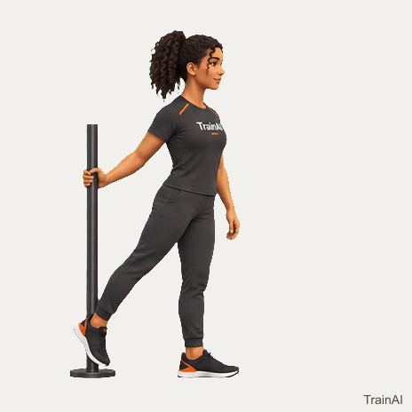

### 3. 站姿髋绕环

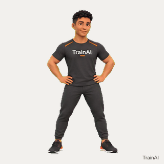

### 4. 罗马尼亚硬拉

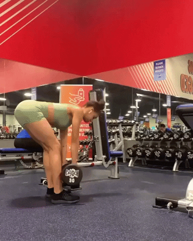

### 5. 仰卧主动直腿抬高

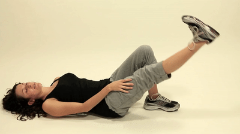

### 6. 半劈叉／动态半劈叉

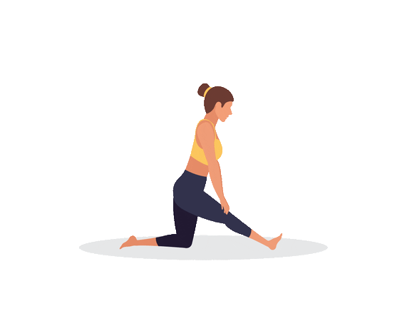

### 7. 反向弓步

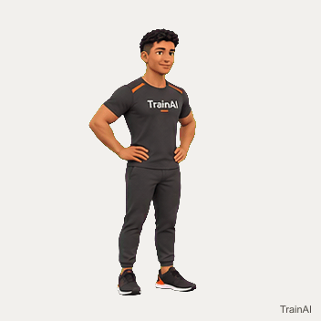

### 8. 跪姿髋屈肌拉伸

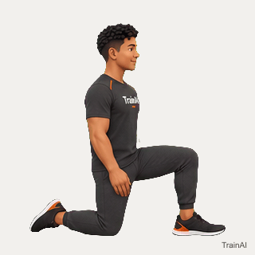

### 9. 沙发式股四头拉伸

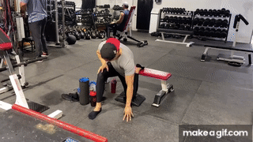

### 10. 臀桥

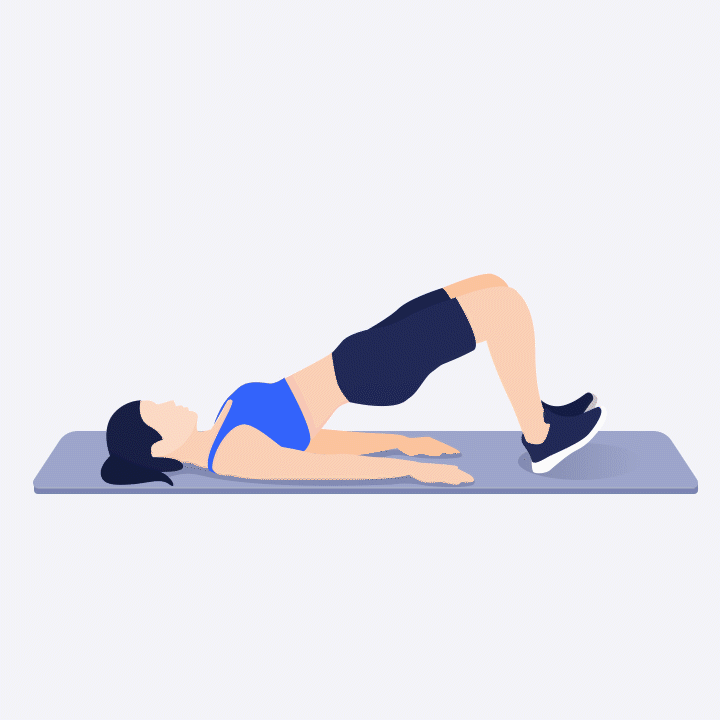

### 11. 保加利亚分腿蹲

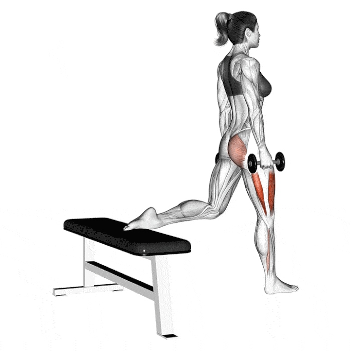

### 12. 侧向弓步

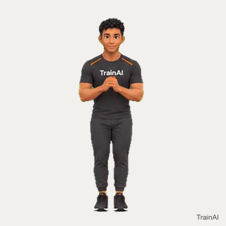

### 13. 单腿臀桥

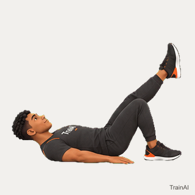

### 14. 低弓步／动态低弓步

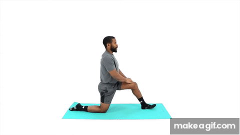

### 15. 腘绳肌 PNF

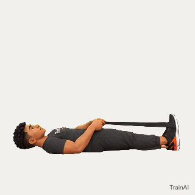

### 16. 髋屈肌 PNF

### 17. 支撑竖叉

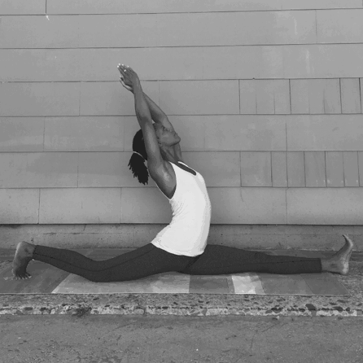

### 18. 竖叉位“拖地”等长

### 19. 方髋滑入竖叉

## 安全阈值

可以继续：均匀的肌肉拉伸感约3–6/10，能够持续呼吸，第二天轻微酸胀且活动后缓解。

立即停止：锐痛、撕裂感、麻木、放射痛、关节深处卡压，或膝盖、腹股沟、坐骨附近明确刺痛。若疼痛超过24小时、影响走路或出现瘀青肿胀，应停止训练并就医。

## 复测方法

每周只测一次，固定在周五热身后、正式训练前。记录：

- 左腿在前时，骨盆最低点离地高度
- 右腿在前时，骨盆最低点离地高度
- 训练后24小时疼痛/不适分数（0–10）

不要冷身测试。连续两周高度没变化，但方髋更稳定、动作更轻松，同样属于进步。

## 编排依据

- [American Heart Association：Flexibility Exercise](https://www.heart.org/en/healthy-living/exercise-and-physical-activity/fitness-basics/flexibility-exercise-stretching)
- [静态拉伸剂量系统综述与Meta分析](https://pubmed.ncbi.nlm.nih.gov/39614059/)
- [抗阻训练改善活动范围的系统综述](https://pubmed.ncbi.nlm.nih.gov/36622555/)
- [Front Split 主要受限肌群说明](https://www.daniwinksflexibility.com/bendy-blog/what-muscles-do-i-need-to-stretch-for-the-front-splits)
- [TrainAI 标准动作 GIF 目录](https://www.trainaiapp.com/exercise-media/)
- [Bheemashakti Yoga School 竖叉动作 GIF](https://www.bheemashakti.yoga/model-class-1)

本计划用于一般健身与柔韧训练，不替代医疗诊断或康复处方，也不要让他人推压身体进入竖叉。
